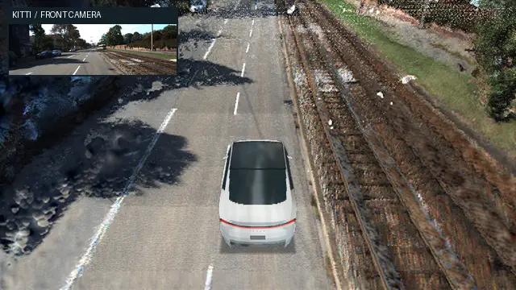
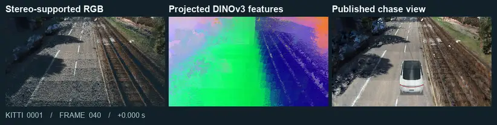
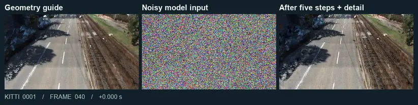
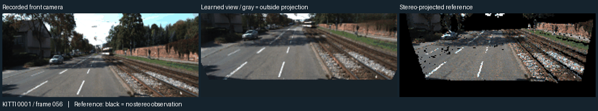

# Tesla FSD V15 Deployment Attempt

[中文说明](README.zh-CN.md) · [Tesla's official demo](https://www.youtube.com/watch?v=eNBqkc7V1nU) · [Our renderer on real KITTI footage](neural/chase/result/sync.mp4)

**Independent research project.** This deployment runs an offline recreation of the Reality View visualization on recorded KITTI footage. The implementation uses independently written code and publicly available models. The project is unaffiliated with Tesla and has no access to its FSD software or weights. [Copyright and attribution](#copyright-and-attribution)

How can a car show the road behind it from a camera that sits above its roof? Tesla described how its driving network and its Reality View renderer share visual features. This project explores the rendering side on a recorded drive, where we can trace which parts of the virtual view have support from real camera observations.

## How Tesla describes FSD V15 Reality View

1. **One visual history feeds two branches.** Tesla's Universal Vision Encoder (UVE) supplies a recent sequence of features. According to Elon Musk, a roughly 3B-parameter model uses those features to produce driving actions. A separate roughly 1B-parameter conditional mean-flow model reads the same features to render the display. The visualization branches from perception, before the action output. [Musk's technical description](https://x.com/elonmusk/status/2124458557525397780)
2. **The renderer also reads its own previous output.** It adds noise to the previous Reality View generation, then uses the recent UVE features to denoise toward the current view. The official demo shows the resulting view from a virtual camera above the vehicle. [Technical description](https://x.com/elonmusk/status/2124458557525397780) · [Tesla video](https://www.youtube.com/watch?v=eNBqkc7V1nU)
3. **The encoder and display run on different clocks.** Musk reports 18 Hz UVE updates and eight generated images per chunk at 36 fps. Eight frames span about 222 ms of playback, the same duration as four UVE cycles. Generation is spread over those four cycles. The 36 fps figure describes display cadence. [Timing and compute details](https://x.com/elonmusk/status/2124458557525397780)

## What this project uses in place of Tesla's components

The public description gives the branch connections and timing. We have no Tesla checkpoint, UVE specification or training recipe for this implementation. The repository contains **a small two-branch architecture experiment** and **a separately trained renderer that produced the chase videos**.

| Component | Independent implementation | What we verified |
| --- | --- | --- |
| Visual encoder | Frozen Meta DINOv3 ViT-S/16. The architecture experiment fuses camera and time-indexed tokens. The chase renderer projects three principal components of left-camera features onto stereo surfaces. | Pretrained features on KITTI stereo images. [Feature visualization](neural/kitti-dinov3/features.jpg) |
| Driving and video branches | A shared feature tensor feeds an action head and an eight-frame video head. Both full-size configurations are parameter counts only. | The small interface test emitted two action values and eight RGB frames, with finite gradients. The action head is untrained. [Test record](neural/kitti-dinov3/branches.json) |
| Virtual camera and geometry | KITTI stereo and vehicle poses place current and past road observations under a fixed chase camera. The separate occupancy baseline exports 20 cm voxels. The chase renderer consumes projected surfaces and a coverage mask directly. | We can mark the supported pixels in every chase frame. [Projection code](neural/chase/scene.py) · [Occupancy baseline](baselines/stereo/README.md) |
| Recurrent video generation | For the chase clip, we warp the previous background into the new pose, add noise, then run five conditional DDIM steps using the geometry guide, support mask and DINO features. A procedural sedan is composited last. A separate fixed-view experiment trains a small mean-flow head. | The chase video is rendered one frame at a time offline. Its timing comes from KITTI. [Chase sampler](neural/chase/diffusion.py) · [Mean-flow experiment](neural/raised_view.py) |

## Visual comparisons

**Tesla's demonstration and the KITTI result.** Watch how the road moves beneath the elevated camera. Tesla shows a real-time in-car visualization. Our renderer follows a fixed camera 9.2 m behind and 4.7 m above the left camera on one KITTI drive. The clips use different roads and camera systems. We have no paired Tesla output or recorded overhead target for a pixel-level comparison. [Watch Tesla Reality View](https://www.youtube.com/watch?v=eNBqkc7V1nU) · [Watch our render with the synchronized front camera](neural/chase/result/sync.mp4)

[](neural/chase/result/sync.mp4)

### Where does the road texture come from?

[](media/stereo-support.mp4)

Follow the lane marking as it passes under the car. Left shows the color guide only where current or earlier stereo observations support a surface. Dark gaps have no stereo support. Middle shows projected DINO feature colors. Right shows the final composite, including approximate projection and learned completion. On average, stereo supports **57.9% of background pixels** across the 68 frames. [Full comparison](media/stereo-support.mp4) · [Per-frame coverage](neural/chase/result/timing.csv)

### What does the denoiser actually receive?

[](media/history-denoising.mp4)

Left shows the previous generated background aligned to the current pose. Frame 040 starts from the geometry guide. Middle shows the actual noisy tensor passed to the denoiser, clipped for RGB display. Right shows the background after five updates and the detail pass, before the car is added. Watch the right-hand fence for stretched texture as the car passes it. Both comparison MP4s preserve all 68 KITTI presentation timestamps over 7.016 seconds. [Full comparison](media/history-denoising.mp4) · [Sampler](neural/chase/diffusion.py)

### How close is a learned view to the projected reference?

[](neural/kitti-raised/sequence.gif)

This separate experiment raises the camera by 1.5 m. Left is the recorded front image, middle is the learned view and right is the stereo projection used as a reference. On the same 16 held-out frames, the ground-plane RGB warp scored **16.51 dB** and the learned view **19.57 dB** PSNR over the **58.2%** of pixels with a valid reference. These scores apply only to this fixed-view experiment. [Metrics and frame IDs](neural/kitti-raised/metrics.json)

## Try it

**Watch without installing anything.** The full videos, trained chase renderer and per-frame timing data are in [the demo folder](neural/chase/result/).

**Reproduce the clip.** Use Python 3.12 and run the commands below from this repository. Obtain the original Meta checkpoint named `dinov3_vits16_pretrain_lvd1689m-08c60483.pth` from [DINOv3](https://github.com/facebookresearch/dinov3). Both KITTI archives can stay zipped.

```sh
python3 -m venv .venv
. .venv/bin/activate
python -m pip install -r neural/chase/requirements.txt
git clone https://github.com/facebookresearch/dinov3.git vendor/dinov3
git -C vendor/dinov3 checkout 6876159a11b4df116f30f667f8c9888617df0751

mkdir -p data
base=https://s3.eu-central-1.amazonaws.com/avg-kitti/raw_data
curl -fL "$base/2011_09_26_drive_0001/2011_09_26_drive_0001_sync.zip" -o data/drive.zip
curl -fL "$base/2011_09_26_calib.zip" -o data/calib.zip

python neural/chase/render.py \
  --drive data/drive.zip --calib data/calib.zip \
  --meta-repo vendor/dinov3 --checkpoint /path/to/dinov3_vits16_pretrain_lvd1689m-08c60483.pth \
  --cache cache-chase --out run-chase
```

Open `run-chase/sync.mp4` to inspect the rendering alongside the recorded input. Add `--train` to fit the included renderer again. Training uses frames 0–35; the published clip uses frames 40–107 of the same drive.

## What the demo measures

| Property | Result |
| --- | --- |
| Virtual camera | 9.2 m behind and 4.7 m above the left camera, pitched down 27° |
| Video | 768 × 432, variable frame timing from KITTI |
| Synchronization | All 68 encoded timestamps matched the expected microsecond timestamps in both MP4s |
| Inference on the development Mac | About 177 ms/frame for diffusion and composite preparation alone; geometry and encoding add latency |
| Scene fidelity | Stereo coverage is measured. There is no recorded overhead target for this clip. Occluded regions can smear or change between frames. |

[Renderer](neural/chase/render.py) · [Two-camera scene reconstruction](neural/chase/scene.py) · [Conditional diffusion](neural/chase/diffusion.py) · [Timing audit](neural/chase/result/metrics.json)

## Copyright and attribution

- **Tesla.** The Tesla name and product names identify the system discussed here. Tesla retains its rights in its trademarks and official demonstration footage. The official video is linked at its source. This independent project has no affiliation with or endorsement from Tesla. [Tesla intellectual property information](https://www.tesla.com/legal/additional-resources#intellectual-property) · [Official demonstration](https://www.youtube.com/watch?v=eNBqkc7V1nU)
- **KITTI.** Credit for the source footage belongs to Andreas Geiger, Philip Lenz, Christoph Stiller and Raquel Urtasun, *Vision meets Robotics: The KITTI Dataset* (IJRR, 2013). The KITTI images and derived previews, videos, point clouds and occupancy grids here are shared under CC BY-NC-SA 3.0. Reuse requires attribution, noncommercial use and the same license when sharing adaptations. Our modifications include stereo reconstruction, reprojection, learned completion and compositing. [KITTI copyright and citation](https://www.cvlibs.net/datasets/kitti/) · [License](https://creativecommons.org/licenses/by-nc-sa/3.0/)
- **DINOv3.** The experiments use Meta's pretrained DINOv3 ViT-S/16 under the DINOv3 License. Obtain the backbone checkpoint from Meta. The small renderer and video-head checkpoints supplied here were trained for this project. [DINOv3](https://github.com/facebookresearch/dinov3) · [Meta's license](https://github.com/facebookresearch/dinov3/blob/main/LICENSE.md)
