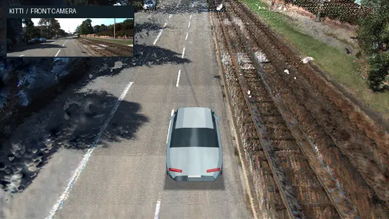

# ChaseView · 把真实行车影像变成第三人称跟车视角

[English](README.md)



受 Tesla Reality View 公开架构启发的独立研究原型。在公开实拍帧上验证共享视觉特征、驾驶分支和视频分支的连接方式。现已训练并附带一个小型固定抬高视角生成分支；驾驶分支仍处于接口验证阶段。[Tesla 官方演示](https://www.youtube.com/watch?v=eNBqkc7V1nU) · [技术说明原帖](https://x.com/elonmusk/status/2124458557525397780)

## 与实拍同步的第三人称跟车视频

[播放跟车视角](neural/chase/result/chase.mp4) · [并排核对同刻实拍和观测范围](neural/chase/result/sync.mp4) · [逐帧时间戳](neural/chase/result/timing.csv) · [导出核验](neural/chase/result/metrics.json)

虚拟镜头位于左前相机后方 9.2 米、上方 4.7 米，向下俯拍 27°。镜头刚性跟随实车的逐帧惯导位姿，银色轿车由程序绘制，作为自车位置和尺度的参照。前向相机没有拍到本车外观。

为评估预训练视频渲染器，另导出同一机位的[模糊 RGB 控制视频](neural/chase/result/control-blur.mp4)，保留 68 个原始显示时刻和自车轮廓。这份文件可用于 Cosmos3-Nano-Sim-Transfer 的 blur 条件实验。第三方模型的推理质量与端到端时延尚待测试。[官方模型卡](https://huggingface.co/nvidia/Cosmos3-Nano-Sim-Transfer)

**视角重建与补画。** 使用 KITTI Raw 0001 的同步左右实拍、双目标定及 OXTS 位姿，在线式地向后查看最多 12 个隔帧历史关键帧。投影中做深度遮挡检查，将已经驶过的地面放回车旁和车尾。DINOv3 ViT-S/16 提供当前实拍图的视觉特征。在几何支持不足的位置，使用地面或远景投影、邻近纹理以及上一幅生成画面作为条件。按相邻相机位姿重新投影上一帧，加入高斯噪声，通过五步确定性 DDIM 更新补全当前视图，并保留有几何支持的高频细节。生成器为本项目训练的小型条件卷积网络；该方案加入了显式双目几何和惯导信息。

**训练和显示。** 在 0–35 号帧上训练条件去噪器，目标为双目投影得到的实拍颜色。随机挖空区域用于训练补全，历史输入在训练时由平移和模糊近似。导出 40–107 号帧时使用实际前一幅生成结果。输入仅有前向双目，历史观测能够补充近场，未曾拍到的物体或遮挡区域缺乏独立真值。同步版右下角以蓝绿色标出有当前或历史双目表面支持的像素，以橙色标出补画或近似投影，以浅灰色标出自车模型。

**时序。** 两个 H.264 MP4 均使用原始相机时间戳决定每一帧的显示时刻。首帧为时间零点，容器时间基为微秒，最后一帧持续时间取片段间隔的中位数。导出后核对每个包的显示时间及末帧时长，并完整解码两份视频。播放以实车节奏呈现；计算耗时与播放时长是独立指标。

复现时使用官方完整同步序列和标定压缩包。设置 DINO 权重与官方源码目录的步骤见下文。脚本默认加载项目附带的扩散权重，追加 `--train` 可重新拟合。

```sh
python -m pip install -r neural/chase/requirements.txt
python neural/chase/render.py --drive 2011_09_26_drive_0001_sync.zip --calib 2011_09_26_calib.zip \
  --checkpoint "$weights" --meta-repo vendor/dinov3 --cache cache-chase --out run-chase
```

## 实拍输入与生成画面


使用 KITTI 0001 实拍双目和官方相机标定，将虚拟镜头上移 1.5 米、后移 1 米、向下俯拍 14 度。左栏为原始左相机，中栏为 224×96 的神经网络结果，右栏为双目测深后投影的参考。中栏的灰区由标定与地平面投影范围决定；右栏黑色代表缺少深度观测。两个掩码相互独立。

**在同一路段做时间留出。** 训练使用第 0–47 帧。首次探索使用第 80–103 帧，发现细节发糊。确定浅层纹理改动后，最终比较使用第 56–71 帧，按两个八帧块递推。测试时输入来自同时刻和过去的相机帧；后一块沿用前一块的生成结果，首块从零初始化。没有跨路线泛化或车端时延实测。

| 同一批 16 帧的对照 | 可观测参考像素 PSNR |
|---|---:|
| 训练集逐像素均值 | 12.67 dB |
| 校准地平面投影原始 RGB | 16.51 dB |
| 小型生成分支，仅粗纹理解码 | 16.84 dB |
| 加入 DINO 浅层纹理读取与学习的投影修正 | **19.57 dB** |

双目参考覆盖目标视图的 **58.2%**。评分使用这些位置上的原始模型输出，显示掩码不参与评分。参考深度也有误差。KITTI 没有在所选虚拟机位架设真实相机，这组数值只能衡量对投影参考的拟合程度。

**独立实现的细节。** 冻结 DINOv3 ViT-S/16，取两个中间层的双目特征。单独从左相机的 DINO patch 嵌入学习线性纹理读出器，只用训练帧拟合。用地面先验定位纹理、学习局部坐标修正，再经因果时序 Transformer、带噪历史块和条件均值流损失训练。视频头训练 500 步，约 32 万个可梯度更新的参数，另外保存线性读出权重。训练及评分阶段计算双目深度生成参考；视频分支的推理输入为视觉特征、固定视角标定先验及带噪历史。此实验单独验证视频分支。近场遮挡、车后环境、绕车全景和驾驶质量均未验证。[训练与验证代码](neural/raised_view.py) · [权重](neural/kitti-raised/raised-flow.pth) · [最终指标](neural/kitti-raised/metrics.json)

在仓库根目录使用官方 KITTI 同步序列、同日标定和本地 DINOv3 权重。Meta 源码设置见下方预训练特征章节。以下命令重放附带的权重。移除 `--load-head` 参数及其路径可重新训练。

```sh
python -m pip install -r requirements.txt -r neural/requirements.txt
python neural/raised_view.py --drive 2011_09_26_drive_0001_sync.zip --calib 2011_09_26_calib.zip \
  --checkpoint "$weights" --meta-repo vendor/dinov3 --out run-raised \
  --load-head neural/kitti-raised/raised-flow.pth
```

## 公开信息与本项目的实现选择

| 环节 | 官方披露 | 本项目的独立选择与状态 |
|---|---|---|
| 感知 | 两个分支共享近期 UVE 特征 | 用 DINOv3 ViT 提取各视角 patch，冻结骨干，保留 2×4 空间网格，加入相机编号和时间位置，用 Transformer 融合。该融合器需训练。支持 Meta 原始 .pth 及 Hugging Face 格式权重。 |
| 驾驶 | 约 3B 参数模型输出驾驶动作 | 参考配置约 30.59 亿参数，假设输出两个连续控制量。尚无动作标签训练或实车控制接口。 |
| 画面 | 约 1B 条件均值流模型读取同一组特征，给上次生成结果加噪并生成新画面 | 参考配置约 10.23 亿参数。独立选择 RGB patch Transformer、整块历史回馈、加性高斯噪声、零值冷启动、线性训练路径和单步更新。实现了均值流损失及时间导数，层数、宽度和损失配方属于项目假设。[MeanFlow 论文](https://proceedings.neurips.cc/paper_files/paper/2025/hash/6d13e085b79d454da5910e4ca82a3d9d-Abstract-Conference.html) |
| 时间与计算 | UVE 为 18 Hz，生成八帧短块，36 fps 播放，生成计算跨四个 UVE 周期 | 代码每块输出八帧。本机测试使用缩小模型；参考配置仅统计参数。18 Hz 输入调度、36 fps 实时吞吐和车端芯片预算均待验证。 |
| 视点 | 虚拟机位在本车上方 | 目前 KITTI 前向双目只提供街面视点，缺乏同刻俯视真值。训练俯视生成需要另行取得目标视点监督；当前测试也未验证自由视点控制。 |

## 在真实图像上复现接口检查

下载 KITTI Raw 的[校正同步序列](https://s3.eu-central-1.amazonaws.com/avg-kitti/raw_data/2011_09_26_drive_0001/2011_09_26_drive_0001_sync.zip)和[同日标定](https://s3.eu-central-1.amazonaws.com/avg-kitti/raw_data/2011_09_26_calib.zip)。脚本直接读取原始 ZIP。

建议 Python 3.11 或 3.12。在仓库根目录运行：

```sh
python -m pip install -r neural/requirements.txt
python neural/check_kitti.py --drive 2011_09_26_drive_0001_sync.zip --check-wiring
```

这条命令使用小型随机初始化的 DINOv3 结构进行接口测试。实际输入是 KITTI 左右相机 0、6 号帧，右相机 12 至 54 号帧按步长 6 抽取，用于检查八帧损失和梯度。它们的采样间隔和目标视点都与 V15 披露的运行条件不同。测试验证共享特征、两个输出、历史生成回馈以及梯度传播。测试不会导出未训练网络生成的随机画面。参考配置以 meta 张量统计参数。

## 预训练 DINOv3 的实拍验证

本次使用 Meta 原始 ViT-S/16 权重，SHA-256 前缀为 `08c60483`。加载时严格匹配所有参数。KITTI 同一序列取 18 个时刻的左右相机图像，共 36 张。图像缩放为 640×192，每张的稠密特征为 12×40×384。下图用同一组 PCA 主轴展示两个时刻的左相机特征。颜色代表特征投影；语义类别和几何误差需要单独评测。


缩小的分支接口测试使用另一组 160×64 输入和 2×4 池化网格，也已通过预训练骨干前向、历史回馈与融合层梯度检查。这项接口测试使用随机任务头；上方的固定视角实验另外训练了小型视频分支。[特征记录](neural/kitti-dinov3/features.json) · [分支记录](neural/kitti-dinov3/branches.json)

在仓库根目录运行，按本机位置设置权重路径。Meta 源码版本与本次验证一致。[Meta 官方仓库](https://github.com/facebookresearch/dinov3)

```sh
git clone https://github.com/facebookresearch/dinov3.git vendor/dinov3
git -C vendor/dinov3 checkout 6876159a11b4df116f30f667f8c9888617df0751
weights="/path/to/dinov3_vits16_pretrain_lvd1689m-08c60483.pth"
drive="2011_09_26_drive_0001_sync.zip"
python neural/check_kitti.py --drive "$drive" --meta-repo vendor/dinov3 --checkpoint "$weights"
python neural/inspect_kitti.py --drive "$drive" --meta-repo vendor/dinov3 --checkpoint "$weights" --out run-features
```

## 真实几何对照实验

[实拍和传统双目重建动图](baselines/stereo/kitti-result/sequence.gif) · [首帧原始双目图](baselines/stereo/kitti-result/stereo000.png) · [逐帧结果](baselines/stereo/kitti-result/metrics.json)

为验证数据与标定，独立运行传统双目基线。KITTI Raw 2011_09_26_drive_0001 的 0 至 102 号帧每隔 6 帧抽取一次，共 18 对。重建只读取校正后的左右 RGB 与相机标定。将单帧 Velodyne 投影到左图，以每个像素最近的返回作独立参考，在 3–40 米内总计 316,427 个参考像素。253,826 个位置有有效双目深度，覆盖率 80.2%，匹配点的深度绝对误差中位数为 0.290 米，P95 为 2.731 米。统计基于一条路线，且不含跨传感器遮挡修正。

同一份结果包含首帧三态占用栅格和带颜色的表面点。栅格坐标的三轴为右、前、上，原点参照左相机光心。体素边长 20 cm。可视化的暗区包含缺少观测的空间。这批测量描述经典双目基线的前向几何效果；本页上方另列小型神经视频分支的独立结果。

```sh
python -m pip install -r requirements.txt
python baselines/stereo/kitti.py --drive 2011_09_26_drive_0001_sync.zip --calib 2011_09_26_calib.zip --out run-kitti
```

KITTI Raw 图像与衍生预览、点云、占用结果遵循 [CC BY-NC-SA 3.0](https://creativecommons.org/licenses/by-nc-sa/3.0/)。数据来自 Andreas Geiger、Philip Lenz、Christoph Stiller、Raquel Urtasun，*Vision meets Robotics: The KITTI Dataset*，IJRR 2013。衍生修改包括双目测深、体素化、投影及动画排版。[数据集主页](https://www.cvlibs.net/datasets/kitti/raw_data.php) · [授权与引用](https://www.cvlibs.net/datasets/kitti/)
