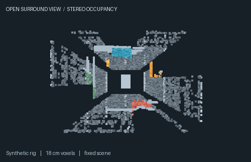

# Open Surround View

从四组朝外的双目 RGB 图像，恢复车周围的占用栅格和三维表面点，再从车外视角绕车查看。这个 CPU 演示受 Tesla Reality View 的产品呈现启发；实现采用公开的经典立体视觉方法。特斯拉在公开说明中描述了共享视觉特征和独立的视频生成分支。这里实现的范围是静态合成场景中的几何重建与可视化。[Tesla 官方演示](https://www.youtube.com/watch?v=eNBqkc7V1nU) · [马斯克原帖](https://x.com/elonmusk/status/2124458557525397780)



中心浅色矩形标示已知的自车位置和尺寸。彩色点表示测得的占用表面；留白可能为空闲，也可能缺少观测，可从栅格文件区分。动画旋转的是虚拟观察视点，场景和采集时刻固定。绿色、黄色等物体为带纹理的合成几何体。

## 运行

需要 Python 3.9+。在仓库根目录执行：

```sh
python3 -m venv .venv
. .venv/bin/activate
python -m pip install -r requirements.txt
python baselines/stereo/demo.py --out run
```

## 输入与算法

[查看四组输入图像](media/stereo.png)。每行对应一个方向，左、右列对应同一方向的两台相机。演示自行生成经过校正的同步双目对，已知内外参、30 cm 基线和 145 px 焦距。立体匹配只读取 RGB；合成器同时生成的深度参考仅用于算误差。

1. 对四组图分别运行 OpenCV StereoSGBM，以左右一致性排除一部分错误匹配。通过视差和已知基线计算公制深度。
2. 将 18 cm 体素的中心投影到各左相机。中心靠近有效测量表面时记为占用；沿同一观测射线、位于表面前方时记为空闲；其余为未知。多个视角冲突时保留表面命中。
3. 导出占用体素中心和对应图像颜色，按深度排序绘制虚拟环绕视图。这个基线恢复可观测表面，尚未实现语义分类、遮挡补全、连续网格、动态跟踪或视频扩散。

普通量产车的四路单目鱼眼采用另一种相机布置。接入这种实车数据需要相应的投影模型和多视图或时序深度估计器；当前脚本的入口是内置双目场景。

## 输出

| 文件 | 内容 |
|---|---|
| `occupancy.npz` | `grid[x,y,z]` 的值为 -1 未知、0 空闲、1 占用。世界坐标以米计，Z 朝上，体素中心为 `origin + (index + 0.5) * voxel_m`。 |
| `surface.ply` | 带 RGB 的三维表面采样点，可用 CloudCompare 或 MeshLab 打开。 |
| `stereo.png`、`orbit.gif` | 四组双目输入和 36 帧环绕预览。 |
| `metrics.json` | 对有效量程内的合成参考像素统计深度覆盖率；在有匹配的像素上统计绝对深度误差。 |

本次样例的有效深度覆盖率为 83.7%，绝对深度误差中位数为 7.3 cm，P95 为 38.2 cm。仅衡量这个有纹理的静态场景里的双目深度。占用准确率、动态场景、实车效果和车载时延仍待测量。
